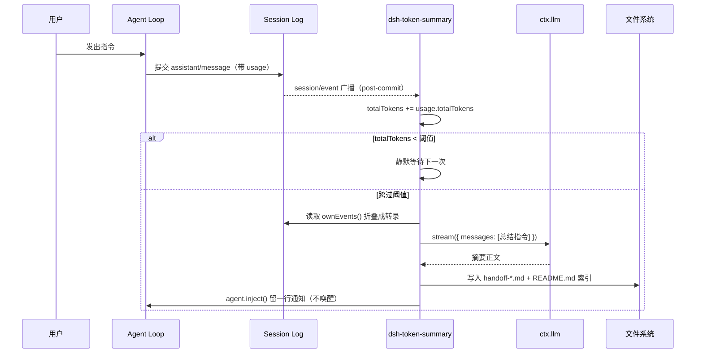

# dsh-token-summary

> 每累计 **50 万 token** 的新增对话，就把会话整理成一份**能直接交接给另一个 Agent 的长文档**。
>
> 不是分片摘要——每份都在前一份基础上累积，越往后越完整。

<p align="center">
  
</p>

<p align="center">
  
  
  
  
  
</p>

---

## 目录

- [它能解决什么问题](#它能解决什么问题)
- [使用场景](#使用场景)
- [工作原理](#工作原理)
- [前置条件](#前置条件)
- [安装](#安装)
- [配置](#配置)
- [输出示例](#输出示例)
- [开发](#开发)
- [画面与后端](#画面与后端)
- [版本管理](#版本管理)
- [已知限制](#已知限制)
- [许可](#许可)

---

## 它能解决什么问题

长会话是编程 Agent 的常态，但它的**记忆只存在于上下文窗口里**：

| 痛点 | 具体表现 | 本插件的解法 |
| --- | --- | --- |
| 上下文被压缩后细节蒸发 | 自动 compaction 只保留摘要，早期的路径、命令、错误信息永久丢失 | 在压缩之前就定期把会话**落盘成独立文件**，不依赖上下文 |
| 会话结束后无法回溯 | 关了窗口 / 换了机器，之前做过什么、为什么这么做没人记得 | 每次归档是一份可检索的 Markdown，含任务目标、决策、未完成项 |
| 长任务的"中途交接"很贵 | 人工翻几百轮对话整理进度要十几分钟 | 模型自动生成结构化总结，直接当交接文档用 |
| 上下文用量不可见 | 不知道这个会话到底烧了多少 token | 归档文件里带累计 token、消息数、工具调用统计 |
| 复盘成本高 | 想知道某个功能是怎么一步步实现的，只能重读全部对话 | 摘要按"目标 / 已完成 / 决策 / 未完成"分节，直接可读 |

一句话：**把易失的上下文，变成可长期保存的 Markdown 资产。**

---

## 使用场景

### 1. 长周期任务的自动交接
一个重构任务跑了几个小时、几百轮工具调用。每跨过 50 万 token 新增内容，插件就把进展合并进交接文档——你随时能拿最新那份交给同事、交给第二天的自己，或者直接扔给另一个 AI 助手让它接着干。

### 2. 事后复盘与知识沉淀
一周后想回顾"那次为什么把缓存层换掉"，不用重读对话，直接看归档文件里的「关键决策与原因」一节。

### 3. 上下文压缩前的保险
自动 compaction 是不可逆的信息损失。本插件在压缩之前就留下完整的 Markdown 快照，等于给历史上了保险。

### 4. 多会话混合工作时的进度追踪
计数器是**全局**的（跨所有会话累计），所以哪怕你同时开五个会话做不同的事，归档节奏依然按总体用量推进——适合把 Harness 当日常主力工具的重度用户。

### 5. 团队协作中的证据留存
`README.md` 索引记录了每一批的时间、批次号、累计 token、会话 ID，形成一条可审计的归档时间线。

---

## 工作原理

### 一句话版本

监听会话事件 → 累加真实计费 token → 跨过阈值时向模型要一份总结 → 写文件 → 留通知。

### 时序图



### 关键设计决策

#### ① 只统计 `assistant/message` 的 provider usage

会话日志里有多种事件，但只有 `assistant/message` 携带 `usage` 字段——那是**服务商真实计费**的记录。

如果改成按字符估算或按消息条数累计，会遇到三个问题：压缩后历史被重写导致重复计数、重放历史被误计、工具输出与实际计费口径不一致。所以计数口径只有一条：

```js
ctx.on('session/event', (session, event) => {
  if (event.type !== 'assistant/message' || event.data.usage === undefined) return;
  const delta = usageTokens(event.data.usage);
  if (delta <= 0) return;
  totalTokens += delta;
  if (totalTokens >= nextThreshold) onThreshold(session);
});
```

#### ② 边界锚定在绝对整数倍上

阈值不是"上次归档后再加 50 万"，而是绝对刻度：`0 → 499,999`、`500,000 → 999,999`……

这样做的原因：一次响应可能一次跨过多个边界（比如阈值调小用于测试时），或用量的粒度很粗。如果按"上次总量 + 间隔"推进，一次超调会让**之后所有批次永久漂移**。

一次触发的所有边界合并成 **一份** 报告，文件里记录「跨越区间数」——而不是每个边界各写一份内容相同的文件（那会产出 N 份雷同归档）：

```js
const boundaries = [];
let cursor = nextThreshold;
while (totalTokens >= cursor) {
  boundaries.push(cursor);
  cursor += config.intervalTokens;
}
// 只写一份，覆盖 boundaries[0] 之前 到 last 之间的区间
```

#### ③ 增量归档：每份只总结新增的部分

这是让短间隔真正有用的关键。归档时只取「自上次归档之后产生的事件」：

```js
const events = session.ownEvents();
const since = sessionCursor.get(session.id) ?? 0;
const fresh = events.slice(since);      // 只要新增的
```

如果每次都总结全部历史，阈值一小，第 N 份就会包含前 N-1 份的全部内容——在 256K 间隔下实测第 5 份有 **80% 与第 4 份重复**，归档价值几乎为零。

游标**只在文件写成功后才推进**：摘要调用失败时那一段内容不会被吞掉，下次触发会重试。

#### ④ 转录预算从尾部向前分配

总结的价值集中在"事情最后做成了什么"。所以当历史超过 `maxTranscriptChars` 时，**先丢最早的内容**：

```js
for (let index = candidates.length - 1; index >= 0; index -= 1) { /* 从最新往回填预算 */ }
```

#### ⑤ 通知用 `inject()` 而不是 `followup()`

`agent.inject()` 把消息放进收件箱但**不唤醒**空闲的 agent。这是刻意的：归档是后台行为，不该因为它凭空开一个 turn、多烧一次钱。`followup()` 会唤醒驱动，那就变成了"插件替你说话"。

#### ⑥ 失败也要留下痕迹

模型调用失败（无路由 / 上游 502 / 超时）时，**仍然写文件**，正文降级为统计兜底并附上失败原因。理由是：漏掉一个批次的记录，比写一个"这次没摘要成功"的文件更糟——后者至少保住了统计和边界事实。

#### ⑦ 不写任何自有状态到会话日志

插件不在 session log 里新增事件类型。原因见 DSH 的约定：读者只在事件带 `ignorable: true` 时才容忍未知类型，而运行时 `append()` 设不了这个标记，写了会导致会话无法重开。所以计数器放在内存里，唯一的日志写入是一条 producer 归属明确的 `user/message` 通知（`kind: 'token-summary'`, `form: 'notice'`）。

---

## 前置条件

| 项目 | 要求 | 说明 |
| --- | --- | --- |
| DeepSeek Harness | `>= 0.2.1-rc.2` | 需要 `session/event` 广播、`ctx.llm.stream()`、`ctx.agents` |
| Node.js | `>= 22` | 使用 `node:fs/promises`、ESM |
| 模型路由 | 至少一个注册了 adapter 的 provider | 用于生成摘要；也可在配置里显式指定 |
| 会话已有过请求 | 或配置了 `provider` + `model` | 否则无法确定摘要路由（此时仍会写统计兜底文件） |
| 写权限 | 对输出目录可写 | 默认为会话工作目录下的 `.dsh-summaries/` |

> 插件本身**不发起任何外部网络请求**，除摘要所需的模型调用外无副作用。

---

## 安装

### 方式一：作为本地 bundle 安装（推荐）

```bash
dsh plugin add /path/to/dsh-token-summary
```

或用 profile 的包管理：

```bash
# 在 profile 目录内
pnpm add link:/path/to/dsh-token-summary
```

并在 `package.json` 的 `dsh.profile.bundles` 中加入 `"dsh-token-summary"`。

### 方式二：手动编辑 `cordis.patch.yml`

```yaml
- insert:
    - id: token-summary
      name: 'dsh-token-summary'
      config:
        intervalTokens: 2000000
        outputDir: ''
        notifyInSession: true
        enabled: true
```

---

## 配置

所有字段都可选。在 `cordis.patch.yml` 的 `token-summary` 行下覆盖即可：

| 字段 | 默认值 | 说明 |
| --- | --- | --- |
| `intervalTokens` | `2000000` | 一个批次覆盖的 token 数（全局累计） |
| `outputDir` | `''` | 输出目录；留空则写入 `<会话工作目录>/.dsh-summaries`，填绝对路径则所有会话集中写入该目录 |
| `provider` | `''` | 摘要用的 provider 路由；**必须与 `model` 同时填写** |
| `model` | `''` | 摘要用的精确模型 id |
| `maxSummaryOutputTokens` | `2048` | 摘要请求的输出 token 上限 |
| `maxTranscriptChars` | `120000` | 送入模型的历史字符上限，超出时从最早的对话开始丢弃 |
| `timeoutMs` | `180000` | 单次摘要请求的端到端超时 |
| `notifyInSession` | `true` | 归档后是否在会话里留一行通知 |
| `enabled` | `true` | 总开关 |

> `provider` / `model` 只填一个时会被忽略并输出警告，路由回退到该会话最近一次请求的 route。

### 路由解析优先级

1. 配置里成对出现的 `provider` + `model`
2. 该会话 `requestHeader()` 中记录的 route
3. 活跃 agent 的 `options`

### 输出位置怎么选

`outputDir` 留空（默认）时，归档跟着会话工作目录走——每个项目一个 `.dsh-summaries/`，
开新项目自动带一份，不会混在一起：

```
/root/work/project-a/.dsh-summaries/handoff-订单重构--txlsf8-0001-500000-....md
/root/work/project-b/.dsh-summaries/handoff-缓存优化--3auzbq-0001-500000-....md
```

填绝对路径则所有会话集中到一处，适合想统一检索、备份或纳入同一个仓库的场景：

```yaml
- id: token-summary
  name: dsh-token-summary
  config:
    outputDir: /root/.dsh/summaries
```

> 切换 `outputDir` 不会搬动已有文件，旧归档留在原目录。需要保留历史就手动迁移，
> 并注意索引 `README.md` 里的路径是写入时的快照。

---

## 输出示例

### 交接文档 `handoff-缓存重构--txlsf8-0002-1000000-2026-11-05T01-30-00-000Z.md`

```markdown
# 工程交接文档 · 第 2 版（每累计 500,000 token 更新）

| 项目 | 值 |
| --- | --- |
| 生成时间 | 2026-11-05T01:30:00.000Z |
| 会话 ID | `session-3fbd1fea-...` |
| 会话标题 | 缓存重构 |
| 工作目录 | `/root/work/my-project` |
| 本批序号 | 第 2 版 |
| 本批区间 | 500,000 → 999,999 token |
| 跨越区间数 | 1 |
| 已覆盖事件数 | 42 |
| 批大小 | 500,000 token |
| 累计 token | 1,000,000 |
| 摘要模型 | api23 / deepseek-flash |
| 用户消息 | 7 |
| 助手消息 | 150 |
| 工具调用 | 188 |
| 工具失败 | 0 |
| 摘要输入字符 | 16,028 |

## 交接正文

### 1. 任务全景
- 用户目标：把缓存层从单层 LRU 改成两级，降低 P99 延迟。
- 硬性约束：L1 进程内、L2 用 Redis、必须有降级方案。

### 2. 当前状态
- 改造完成，压测已跑，待灰度。

### 3. 已完成的工作（逐项）
- `src/cache/index.ts`：单层 LRU → 两级结构，保留 `get`/`set`/`del` 签名，12 处调用点零改动。
- `src/cache/redis.ts`：L2 封装，连接池 10 → 50，超时 200ms。

### 4. 关键决策与理由
- 选 Redis 弃 Memcached：需要 TTL 与 pipeline。
- 熔断策略：连续 5 次失败打开 30 秒，期间只走 L1。

### 5. 文件与路径清单
- `src/cache/index.ts`（修改）· `src/cache/redis.ts`（修改）· `src/cache/__tests__/cache.spec.ts`（新建）

### 6. 命令、配置与数据
- 压测：P99 120ms → 45ms，命中率 92%，回源 QPS ↓78%。

### 7. 遇到的问题与解决
- 连接池默认 10 在高并发下排队：改为 50 并加 200ms 超时，测试环境验证通过。

### 8. 未完成事项与下一步
- **下一步动作**：灰度 10% 流量观察 24 小时。

### 9. 风险与注意
- 熔断期间仅走 L1，命中率与回源压力会上升，需在灰度中观察。

---

由 `dsh-token-summary` 自动生成 · 生成时间 2026-11-05 01:30:00
```

### 索引文件 `README.md`

```markdown
# 工程交接文档索引

由 `dsh-token-summary` 自动维护：累计新增 token 每跨过一个阈值，就把会话整理成一份
可交给另一个 Agent 接着干的长文档。每份都在前一份基础上合并新增内容，越往后越完整。

输出目录：`/root/work/my-project/.dsh-summaries`

## 归档记录

- 2026-11-05 01:20:11 · 第 1 版 · 累计 500,000 token · [handoff-缓存重构--txlsf8-0001-500000-....md](...) · `session-3fbd...`
- 2026-11-05 01:30:00 · 第 2 版 · 累计 1,000,000 token · [handoff-缓存重构--txlsf8-0002-1000000-....md](...) · `session-3fbd...`
```

---

## 开发

### 目录结构

```
dsh-token-summary/
├── index.js            # Host 主模块：监听、计数、编排、落盘、通知
├── logic.js            # 纯函数层：配置归一化、转录折叠、渲染（无副作用，可单测）
├── cordis.patch.yml    # bundle 补丁：插入插件行 + 默认配置
├── package.json        # 清单，声明 dsh.bundle.patch 与 files
├── locale/
│   ├── zh.json         # 插件管理里的中文标题/描述
│   └── en.json
├── icon.svg            # 图标（原创 SVG）
├── selftest.mjs        # 13 项纯逻辑单测
└── e2e.mjs             # 端到端桩测试（假 ctx，不联网、不花钱）
```

### 分层原则

**`logic.js` 不 import 任何 Harness 包**，只吃普通数据、吐普通数据。带来两个好处：

1. 可以在没有 Harness 进程的情况下直接 `node selftest.mjs` 验证；
2. Harness 内部包改名/重构时，纯逻辑层完全不受影响。

**`index.js` 只用 Node 内置模块 + 自己的 `./logic.js`**。Harness 服务一律通过 `ctx` 按名字取（`ctx.llm`、`ctx.get('agents')`），从不 `import '@deepseek-ai/dsh-*'`。

> 这不是洁癖：bundle 常以 `link:` 方式安装，而链接目录里的包**解析不到** Harness 的私有包。只依赖内置模块，插件在版本升级和链接安装下都能活。

### 核心模块职责

| 模块 | 职责 | 关键导出 |
| --- | --- | --- |
| `logic.js` | 配置归一化、usage 计价、转录折叠、prompt 构造、Markdown 渲染 | `normalizeConfig` `buildTranscript` `renderMarkdown` `usageTokens` `clip` |
| `index.js` | 生命周期监听、阈值判断、串行队列、模型调用、文件写入、会话通知 | `apply` `inject` `name` |

### 可选服务的读取方式

```js
const optional = (key) => {
  try { return ctx.get(key); } catch { return undefined; }
};
```

用 `ctx.get('agents')` 而不是 `ctx.agents`：后者在服务缺失时会**抛异常**，而这些是可选能力（精简 profile 可能既没挂 agent 注册表也没挂会话标题服务）。

### 并发安全

多个会话可能同时跨过阈值。用一个 promise 队列串行化，保证不会有两个会话同时写同一批次、互相覆盖：

```js
let queue = Promise.resolve();
queue = queue.then(async () => { /* 逐边界写文件 */ }).catch(...);
```

### 运行测试

```bash
node selftest.mjs   # 13 checks：逻辑层
node e2e.mjs        # 端到端：假 ctx，验证归档→写盘→通知全链路
```

`e2e.mjs` 用一个手工造的 Cordis 上下文和 `async function*` 伪流，覆盖了：阈值以下不触发、跨阈值触发、多边界各出一份、模型失败仍写文件、无路由降级、索引只写一次表头。

### 如何扩展

| 想做的事 | 改动点 |
| --- | --- |
| 改成按会话独立计数 | 把 `index.js` 里的全局 `totalTokens` 换成 projection 单元（需要 `ctx.sessionProjections`） |
| 换输出格式（JSON / HTML） | 替换 `logic.js` 的 `renderMarkdown`，或新增并列渲染器 |
| 改摘要 prompt | 改 `logic.js` 的 `SUMMARY_INSTRUCTION` |
| 归档后触发别的动作 | 在 `index.js` 的 `writeSummary` 返回后追加回调 |

---

## 画面与后端

### 当前形态：纯 Host 插件（无自定义界面）

这是一个**后端插件**。它不出现在聊天流里，不新开面板，唯一可见的痕迹是：

- 会话里一行**通知**（`form: 'notice'`，由 Chat 的 context 行渲染）；
- 磁盘上的 Markdown 文件；
- 插件管理页里的一行（标题、描述、图标由 `locale/*.json` 与 `icon.svg` 提供）。

### 为什么不做面板

归档的产物是文件，需求本体就在文件上。加一个仪表盘只是把已有数字再画一遍，却要引入 Client 半边、额外的 slot 注册、主题适配和一套前端状态管理——收益远小于维护成本。所以 v1 刻意不做。

### 如果将来要加前端

Harness 的界面扩展走 Slot 机制，正确的做法是：

```
package.json
  "exports": { "./client": "./client.js" }
  "dsh": { "client": { "platform": "web", "inject": ["@deepseek-ai/dsh-client-ui-conversation"] } }
```

`client.js` 里用 `ctx.slots.inject(...)` + `ctx.slots.register(...)` 挂到比如 `conversation.composer.dock`（会话内嵌）或 `settings.section`（独立设置页）。样式只用 `--dsw-alias-*` 主题 token，不要 import 任何 `@deepseek-ai/dsh-client-*` 包。

届时 Host 侧需要一个数据出口（`ctx.webServer.register({ kind: 'exact', path: '/api/token-summary', ... })`）把计数与归档列表暴露给前端。

### 与后端服务的关系

| 服务 | 用途 | 是否必需 |
| --- | --- | --- |
| `ctx.llm` | 生成摘要 | **必需**（`inject` 声明） |
| `ctx.agents` | 找会话对应 agent、发通知 | 可选 |
| `ctx.sessionTitle` | 归档文件里填会话标题 | 可选 |
| `ctx.sessionProjections` | v1 未用；扩展按会话计数时需要 | 可选 |

---

## 版本管理

本项目遵循 **[语义化版本 SemVer 2.0.0](https://semver.org/lang/zh-CN/)**。

### 版本号规则

| 变更类型 | 版本位 | 例子 |
| --- | --- | --- |
| 破坏性变更（配置字段改名/删除、行为不兼容） | MAJOR | `1.0.0` → `2.0.0` |
| 向后兼容的新功能（新配置项、新输出字段） | MINOR | `1.0.0` → `1.1.0` |
| 向后兼容的修复（bug、文案、性能） | PATCH | `1.0.0` → `1.0.1` |

### 分支模型

```
main      ← 稳定，随时可发布；每个发布打 tag
feat/*    ← 功能分支
fix/*     ← 修复分支
```

### 发布流程

```bash
# 1. 更新 CHANGELOG.md（把 Unreleased 段落改成新版本号，补日期）
# 2. 同步 package.json 的 version
npm version patch|minor|major --no-git-tag-version

# 3. 跑测试
node selftest.mjs && node e2e.mjs

# 4. 打包校验
npm pack --dry-run

# 5. 提交 + 打 tag + 推送
git add -A
git commit -m "chore(release): v1.0.1"
git tag -a v1.0.1 -m "v1.0.1"
git push origin main --tags
```

### 提交信息约定

采用 [Conventional Commits](https://www.conventionalcommits.org/zh-hans/)：

| 前缀 | 含义 |
| --- | --- |
| `feat:` | 新功能 |
| `fix:` | 修复 |
| `docs:` | 文档 |
| `refactor:` | 重构（不改行为） |
| `test:` | 测试 |
| `chore:` | 构建/杂务 |
| `perf:` | 性能 |

### 完整标签列表

```
v1.0.0  ← 首个稳定版：全局累计、模型摘要、Markdown 落盘、会话通知
```

---

## 已知限制

1. **计数器在内存里，随 Harness 重启归零。** 这是刻意取舍：不向会话日志写自有状态，保证 fork / resume / replay 始终可重建。代价是跨重启不累计。
2. **归档的是"跨阈值那一刻所在的那个会话"**。全局计数跨会话共享，但每一批次只总结触发它的那个会话，不是所有会话的总和。
3. **没有 UI 面板**（见上文理由）。
4. **摘要质量取决于转录预算**。`maxTranscriptChars` 设得过小会丢早期上下文，总结会偏向"最近发生了什么"。
5. **对每批次都会产生一次模型调用**。阈值设得过小会显著增加成本；默认 200 万的经验值是：模型往返一次通常远小于此，而一次深度开发会话大致归档 1–2 次。

---

## 许可

[MIT](./LICENSE) © zerolei

---

<p align="center">
  <sub>Built for <a href="https://github.com/deepseek-ai">DeepSeek Harness</a> · 让长会话不再失忆</sub>
</p>